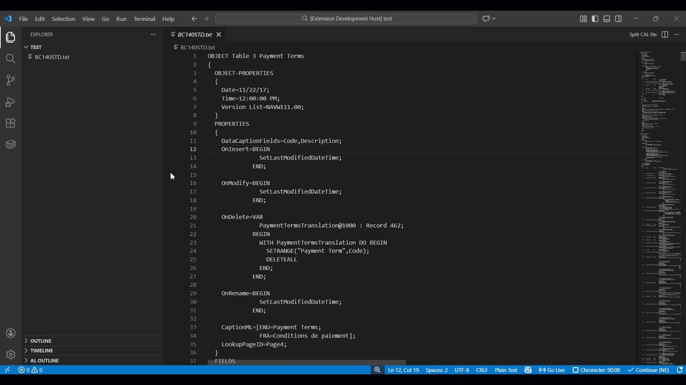

# CAL File Splitter


A VS Code extension that splits a large **Dynamics NAV CAL export file**
into **separate `.txt` files**, one per object.



## ✨ Features
- Split a **big CAL export file** into multiple files.
- One file per object (Table, Page, Report, Codeunit, etc.)
- Automatically saves files in the `src` folder of your workspace
- Configurable output file extension (`.txt` or `.cal`)

## ⚙️ Configuration

- Setting: `calFileSplitter.outputExtension` — controls the output file extension. Options: `.txt` or `.cal` (default: `.txt`).

### Via Settings UI
- Open Command Palette → type "Preferences: Open Settings".
- Search for "CAL File Splitter".
- Set "Output Extension" to `.cal`.

### Via settings.json
Add the following to your user/workspace settings:

```json
{
	"calFileSplitter.outputExtension": ".cal"
}
```
